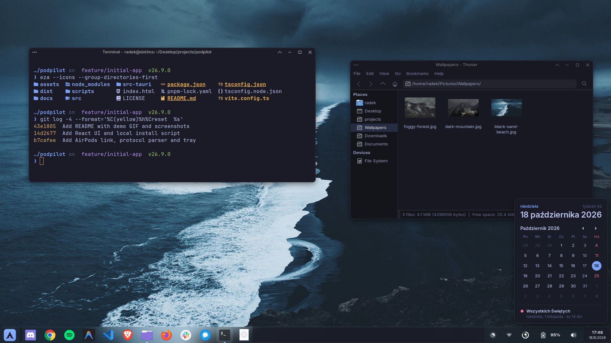
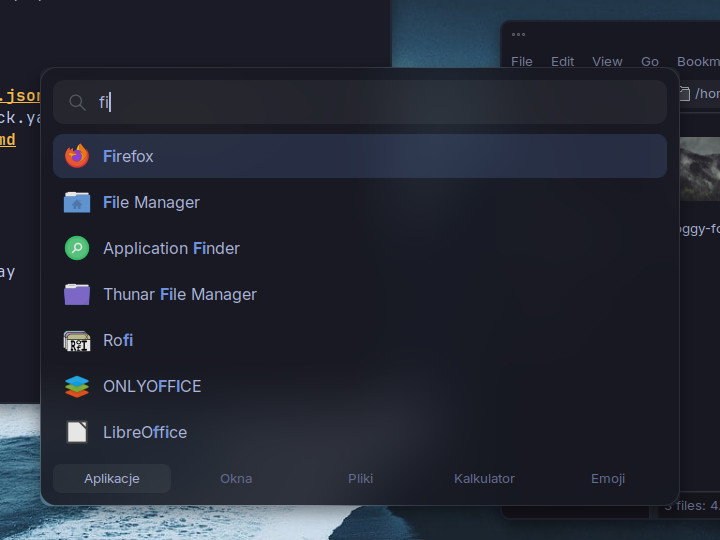
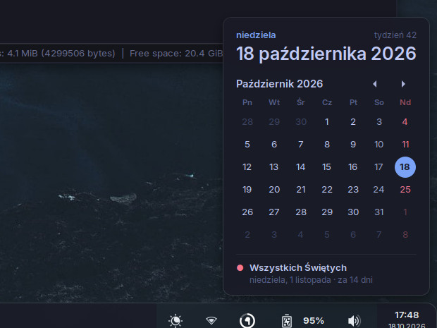
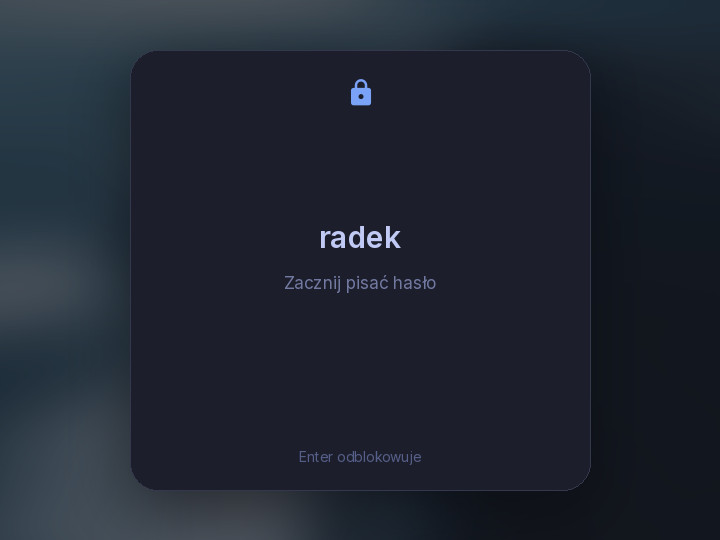

<div align="center">

# Tokyo Night XFCE

**My Arch Linux desktop, restorable with one script.** A glass panel, blurred and rounded windows,
a Spotlight-style launcher, gestures and a lock screen, all in the Tokyo Night palette.



| Launcher | Calendar | Lock screen |
| :---: | :---: | :---: |
|  |  |  |

</div>

## What's inside

- **Windows**: Qogir GTK theme recolored to the terminal navy, matching window frames, picom with
  blur, shadows, rounded corners and open/close animations, dimmed inactive windows.
- **Panel**: glass bar with a dock (dot indicators, no boxes), the Spotify track, tray icons at one
  size and an Arch menu button.
- **Calendar**: click the clock. Weeks start on Monday, Polish public holidays are red and the next
  day off sits at the bottom. Scroll or use the arrows to change the month.
- **Launcher**: rofi in a Spotlight style with tabs for apps, windows, files, a calculator and emoji.
- **Terminal**: xfce4-terminal in Tokyo Night with JetBrains Mono and a Starship prompt.
- **Lock, login and boot**: xsecurelock card, LightDM greeter, GRUB theme and Plymouth splash.

## Shortcuts

| Keys | Action |
| --- | --- |
| `Super+Space` | Launcher |
| `Super+Tab` | All windows at once (skippy-xd) |
| `Super+1` `2` `3` | Workspaces, add `Shift` to move the window |
| `Super+U` `I` `J` `K` | Window to a screen corner |
| `Super+G` | Arrange every window in a grid |
| `Super+V` | Clipboard history |
| `Super+;` / `Super+C` | Emoji / calculator |
| `` Super+` `` | Drop-down terminal |
| `Super+L` / `Super+Esc` | Lock / power menu |
| `Super+/` | Cheat sheet with everything above |

Touchpad: three fingers up shows all windows, down shows the desktop. Four fingers left or right
switches workspaces.

## Install

Arch Linux with XFCE 4.20. The script installs the packages, backs up your current config to
`~/.config/desktop-look-backup-*` and then applies everything.

```sh
git clone https://github.com/Dotims/tokyo-night-xfce.git
cd tokyo-night-xfce
./install.sh            # theme, panel style, launcher, shortcuts, lock screen
./install.sh --panel    # also replace the whole panel layout
./install.sh --boot     # also install the GRUB theme and Plymouth splash
```

From the AUR: `bibata-cursor-theme-bin` for the cursor and `skippy-xd-git` for `Super+Tab`.
Log out and back in once afterwards. The power menu, cheat sheet and calendar are in Polish.

After changing something on the desktop, `./snapshot.sh` copies the current look back into `files/`.

## Credits

[Tokyo Night](https://github.com/tokyo-night/tokyo-night-vscode-theme) palette (MIT),
[Qogir](https://github.com/vinceliuice/Qogir-theme) theme (GPL-3.0, the recolored copy in
`files/themes` keeps that license), [tokyo-night-grub](https://github.com/mino29/tokyo-night-grub)
(MIT), wallpapers from [dharmx/walls](https://github.com/dharmx/walls).

AirPods in the tray come from my other project, [PodPilot](https://github.com/Dotims/podpilot).

## License

Scripts and configs are [MIT](LICENSE). Bundled themes keep their own licenses.
